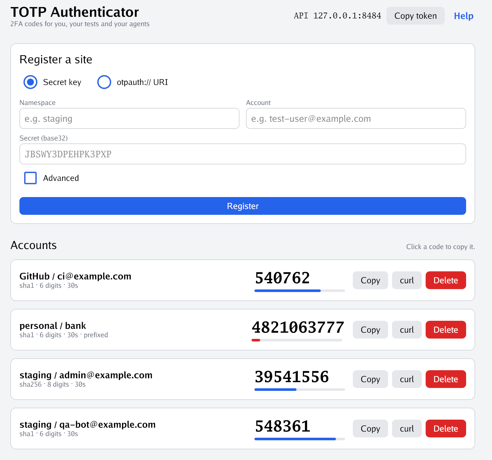
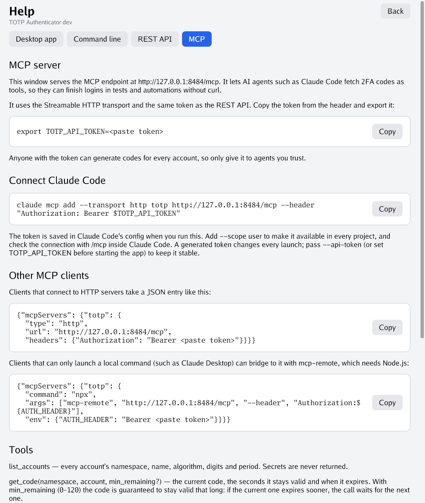

[](https://goreportcard.com/report/github.com/gdrte/totp-go)
[](https://github.com/gdrte/totp-go/actions/workflows/quality-check.yaml)
[](https://coveralls.io/github/gdrte/totp-go?branch=main)

# TOTP Authenticator

**2FA codes for you, your tests and your agents.**

TOTP _(Time-based One-time Password)_ is the most common mechanism for 2FA.
This project keeps your TOTP accounts in an encrypted database and hands out
codes wherever you need them:

- **Desktop app** (`totp-gui`): register sites from a secret key or an
  `otpauth://` URI, watch live codes count down, and copy a code or a
  ready-made command for agents. While it is open it also runs the API and MCP
  servers.
- **MCP server**: AI agents such as Claude Code get `list_accounts`, `get_code`,
  `add_account` and `delete_account` as tools, so they can finish 2FA logins on
  their own.
- **REST API**: test suites and scripts fetch codes over HTTP, and can ask for
  a code that stays valid long enough to submit.
- **Command line** (`totp-cli`): manage accounts and generate codes from the
  terminal.

The desktop app, `totp-cli serve` and both servers share one SQLite database.
Secrets are encrypted at rest and never returned by either server.

<p align="center">
  
</p>

## Contents

- [Install](#install)
- [Desktop app](#desktop-app)
- [MCP server](#mcp-server)
- [REST API](#rest-api)
- [Storage and security](#storage-and-security)
- [Command line](#command-line)
- [Development](#development)

## Install

Download the latest release from the
[releases page](https://github.com/gdrte/totp-go/releases/latest), or build
from source:

| Command                  | Builds                                                    |
|--------------------------|-----------------------------------------------------------|
| `make build-gui`         | `bin/totp-gui`, the desktop app (needs cgo)               |
| `make bundle-gui`        | `bin/TOTP Authenticator.app` with its icon (macOS only)   |
| `make build-gui-windows` | `bin/totp-gui.exe` with its icon, no console window       |
| `make build`             | `bin/totp-cli`                                            |
| `make build-windows`     | `bin/totp-cli.exe`                                        |

The desktop app uses [Gio](https://gioui.org), which needs cgo on macOS and
Linux (on Linux, install Gio's
[system dependencies](https://gioui.org/doc/install/linux) first). Windows
builds need no cgo, so both Windows targets cross-compile from any OS; they
default to amd64, set `WINDOWS_ARCH=arm64` for ARM machines.

The CLI can also be installed with the `go` tool. It is then named `totp-go`
rather than `totp-cli`:

```shell
go install github.com/gdrte/totp-go@latest
```

Release checksums are signed with the GPG key configured for this
repository's releases:

```shell
gpg --verify totp-cli_{{.Version}}_checksums.txt.sig
```

## Desktop app

```shell
make build-gui
./bin/totp-gui                      # API and MCP on http://127.0.0.1:8484
```

On first launch the app asks you to create the database password. **There is
no way to recover a forgotten password.** After that it asks for the password
on every launch, unless `TOTP_PASS` is set.

- **Register a site** with the base32 secret the site shows under "can't scan
  the QR code", or paste the `otpauth://` URI from the QR code; namespace and
  account then default to the URI's issuer and label. **Advanced** sets the
  algorithm, digits, period and a prefix (a PIN some sites expect before the
  code).
- **Use a code**: click it or its **Copy** button. The bar under it shows the
  time left and turns red in the last 5 seconds.
- **Hand it to an agent**: **curl** copies a command that fetches the
  account's current code from the API. **Copy token** in the header copies the
  API token.
- **Help** (in the header and on the unlock screen) has usage notes for the
  app, the MCP server, the REST API and the CLI, with copyable examples that
  use the window's own database path and server address.

Accounts added through the API, MCP or `totp-cli serve` appear in the window
within a few seconds.

Options (all also settable from the environment):

| Flag          | Environment      | Default                          | Description                                  |
|---------------|------------------|----------------------------------|----------------------------------------------|
| `--db`        | `TOTP_SERVER_DB` | `~/.config/totp-cli/server.db`   | Database file, shared with `totp-cli serve`. |
| `--listen`    |                  | `127.0.0.1:8484`                 | Server address. `''` turns the servers off.  |
| `--api-token` | `TOTP_API_TOKEN` | random each launch               | Bearer token for the API and MCP.            |
|               | `TOTP_PASS`      |                                  | Unlocks the database without the prompt.     |

Don't run the app and `totp-cli serve` on the same address at once.

The app icon's source is `cmd/totp-gui/appicon.svg`; after editing it, run
`make appicon` (needs `rsvg-convert` from librsvg) to regenerate
`appicon.png`.

## MCP server

The desktop app and `totp-cli serve` speak the
[Model Context Protocol](https://modelcontextprotocol.io) at `/mcp`
(Streamable HTTP), with the same bearer token as the REST API. Agents use the
stored accounts as tools instead of shelling out to `curl`.

| Tool             | Arguments                                                                                 | Result                                                                  |
|------------------|-------------------------------------------------------------------------------------------|-------------------------------------------------------------------------|
| `list_accounts`  |                                                                                           | Every account's namespace, name, algorithm, digits and period.          |
| `get_code`       | `namespace`, `account`, `min_remaining?`                                                   | The code, the seconds it stays valid and when it expires.               |
| `add_account`    | `secret` or `uri`, `namespace?`, `account?`, `prefix?`, `algorithm?`, `length?`, `timePeriod?` | The registered account. Fails if it already exists.                     |
| `delete_account` | `namespace`, `account`                                                                    | Deletes the account and its secret.                                     |

`get_code` with `min_remaining` (0 to 120 seconds) guarantees the code stays
valid that long: if the current one expires sooner, the call waits for the
next one. Agents should pass it (5 is a good default) right before submitting a
code. Tool errors use the same wording as the REST API, such as
`staging/qa-bot not found`.

The app's **Help** screen has an MCP tab with this setup, filled in with the
window's own address:

<p align="center">
  
</p>

### Connect Claude Code

```shell
export TOTP_API_TOKEN=<token>       # from Copy token, or the one you started with
claude mcp add --transport http totp http://127.0.0.1:8484/mcp \
  --header "Authorization: Bearer $TOTP_API_TOKEN"
```

Add `--scope user` to make it available in every project, and check the
connection with `/mcp` inside Claude Code. A generated token changes on every
launch, so start the app or server with a fixed `--api-token` (or
`TOTP_API_TOKEN`) for a lasting setup.

### Other MCP clients

Clients that connect to HTTP servers take an entry like this:

```json
{
  "mcpServers": {
    "totp": {
      "type": "http",
      "url": "http://127.0.0.1:8484/mcp",
      "headers": { "Authorization": "Bearer <token>" }
    }
  }
}
```

Clients that can only launch a local command, such as Claude Desktop, can
bridge to it with [mcp-remote](https://www.npmjs.com/package/mcp-remote)
(needs Node.js):

```json
{
  "mcpServers": {
    "totp": {
      "command": "npx",
      "args": ["mcp-remote", "http://127.0.0.1:8484/mcp", "--header", "Authorization:${AUTH_HEADER}"],
      "env": { "AUTH_HEADER": "Bearer <token>" }
    }
  }
}
```

### Example prompts

```
List my TOTP accounts.
Log in to staging as qa-bot; when asked for 2FA, use get_code with min_remaining 5.
Register this otpauth URI under the namespace staging: otpauth://totp/...
```

### Troubleshooting

A `401` means the token is missing or wrong (a generated token changes on
every launch). A `403` means the request reached localhost under another host
name; use `127.0.0.1` or `localhost` in the URL. To check the endpoint without
an agent:

```shell
curl -s http://127.0.0.1:8484/mcp \
  -H "Authorization: Bearer $TOTP_API_TOKEN" \
  -H 'Content-Type: application/json' \
  -H 'Accept: application/json, text/event-stream' \
  -d '{"jsonrpc":"2.0","id":1,"method":"tools/list"}'
```

The endpoint is stateless: it keeps no sessions and answers every request
with JSON.

## REST API

The desktop app serves the API while it is open. To run it without a window,
for example on a CI machine, use `totp-cli serve`:

```shell
export TOTP_PASS=...                # database password (or you'll be prompted)
export TOTP_API_TOKEN=$(openssl rand -hex 32)
totp-cli serve                      # API and MCP on http://127.0.0.1:8484
```

`serve` takes the same `--db`, `--listen` and `--api-token` options as the
desktop app. If no token is set, it generates one and prints it on startup.
`totp-cli serve --import` first copies the CLI's accounts into the database
(accounts that already exist are skipped).

Every endpoint except `health` requires `Authorization: Bearer <token>`.
Secrets are never returned.

| Method   | Path                                           | Description                         |
|----------|------------------------------------------------|-------------------------------------|
| `GET`    | `/api/v1/health`                               | Liveness check (no auth).           |
| `GET`    | `/api/v1/accounts`                             | List accounts (without secrets).    |
| `POST`   | `/api/v1/accounts`                             | Register an account.                |
| `DELETE` | `/api/v1/accounts/{namespace}/{account}`       | Delete an account.                  |
| `GET`    | `/api/v1/accounts/{namespace}/{account}/code`  | Current code.                       |
| `POST`   | `/mcp`                                         | [MCP server](#mcp-server).          |

### Get a code

Pass `min_remaining=N` (0 to 120) to make sure the code stays valid for at
least `N` more seconds. If the current window is closer than that to expiring,
the request waits for the next one, so a test never submits an expired code:

```shell
curl -s -H "Authorization: Bearer $TOTP_API_TOKEN" \
  'http://127.0.0.1:8484/api/v1/accounts/staging/qa-bot/code?min_remaining=5'
```

```json
{"expiresAt":"2026-09-29T15:39:30Z","namespace":"staging","account":"qa-bot","code":"086405","remaining":27,"timePeriod":30}
```

### Register an account

Send a base32 secret, or the `otpauth://` URI that sites encode in their setup
QR code. Namespace and account default to the URI's issuer and label, and
explicit fields override values from the URI:

```shell
curl -s -H "Authorization: Bearer $TOTP_API_TOKEN" -X POST \
  http://127.0.0.1:8484/api/v1/accounts \
  -d '{"namespace":"staging","account":"qa-bot","secret":"JBSWY3DPEHPK3PXP"}'

curl -s -H "Authorization: Bearer $TOTP_API_TOKEN" -X POST \
  http://127.0.0.1:8484/api/v1/accounts \
  -d '{"uri":"otpauth://totp/GitHub:ci@example.com?secret=JBSWY3DPEHPK3PXP&issuer=GitHub"}'
```

Optional fields: `prefix`, `algorithm` (`sha1`, `sha256`, `sha512`), `length`
(digits) and `timePeriod` (seconds). It returns `201`, or `409` if the account
exists.

### List and delete

```shell
curl -s -H "Authorization: Bearer $TOTP_API_TOKEN" http://127.0.0.1:8484/api/v1/accounts
curl -s -H "Authorization: Bearer $TOTP_API_TOKEN" -X DELETE \
  http://127.0.0.1:8484/api/v1/accounts/staging/qa-bot
```

Errors are JSON, such as `{"error":"staging/qa-bot not found"}`: `400` bad
request, `401` missing or wrong token, `404` unknown account, `409` already
exists.

On Windows the curl examples work in Git Bash or WSL. In PowerShell, use
`Invoke-RestMethod`:

```powershell
$env:TOTP_API_TOKEN = '<token>'
Invoke-RestMethod -Headers @{Authorization = "Bearer $env:TOTP_API_TOKEN"} `
  "http://127.0.0.1:8484/api/v1/accounts/staging/qa-bot/code?min_remaining=5"
```

## Storage and security

- The database (default `~/.config/totp-cli/server.db`) stores account names
  and settings in plain columns. Each secret and prefix is encrypted with
  [age](https://github.com/FiloSottile/age) to a key created with the
  database, and that key is encrypted with your password. A copy of the
  database file alone reveals no secrets.
- Every request reads the database directly, so nothing is cached in memory
  and the app, `serve` and the CLI never see stale data.
- The servers listen on localhost by default. Anyone holding the API token can
  generate codes for every stored account, so treat it like the password, and
  only bind beyond localhost (`--listen`) on a network you trust.
- Requests that reach a localhost address under a non-localhost host name are
  rejected, to block DNS-rebinding attacks from web pages.

## Command line

`totp-cli` manages accounts in its own encrypted credentials file
(`~/.config/totp-cli/credentials`, or the path in `TOTP_CLI_CREDENTIAL_FILE`),
separate from the desktop app's database. Copy them into the database with
`totp-cli serve --import`. Each command asks for the file's password; the
first run creates it. **There is no way to recover a forgotten password.**

| Command                       | Description                                                       |
|-------------------------------|-------------------------------------------------------------------|
| `add-token`, `add`            | Add an account.                                                   |
| `generate`, `g`               | Generate a code.                                                  |
| `list`                        | List namespaces, or the accounts in one.                          |
| `update`                      | Change an account's length, prefix, algorithm or period.          |
| `set-length`, `set-prefix`    | Change an account's length or prefix.                             |
| `rename`                      | Rename an account or a namespace.                                 |
| `delete`                      | Delete an account or a whole namespace.                           |
| `change-password`             | Change the credentials file's password.                           |
| `dump`, `import`              | Export all accounts (secrets included) as YAML, or import them.   |
| `instant`                     | Generate a code from `TOTP_TOKEN` or stdin without storing it.    |
| `serve`                       | Run the [REST API](#rest-api) and [MCP server](#mcp-server).      |

Run `totp-cli help <command>` for a command's options.

```shell
# Add an account (leave out the arguments to be prompted)
totp-cli add-token personal github
totp-cli add-token --length=8 --algorithm=sha256 --prefix=mypin personal github

# Generate codes
totp-cli generate personal github
totp-cli generate --show-remaining personal github     # 316762 (remaining time: 17s)
totp-cli generate --follow personal github             # prints each new code

# List, change and delete
totp-cli list
totp-cli list personal
totp-cli set-prefix --clear personal github
totp-cli rename account personal github github-work
totp-cli delete personal github-work

# Back up and restore
totp-cli dump --output backup.yaml
totp-cli import --input backup.yaml
```

`import` reads the same YAML that `dump` writes, and asks before overwriting
an existing account:

```yaml
- name: personal
  accounts:
    - name: github
      token: JBSWY3DPEHPK3PXP
    - name: bank
      token: GEZDGNBVGY3TQOJQ
      prefix: mypin
```

### Passing the password

The password unlocks every stored secret, so avoid putting it on the command
line (it ends up in shell history) or in environment variables on shared
systems. For automation, the CLI reads the password from stdin, so you can
keep it encrypted and pipe it in, for example with age:

```shell
age --encrypt --armor --recipient <your age public key> \
  > ~/.config/totp-cli/totp-password.age

age --decrypt --identity ~/.age/key.txt ~/.config/totp-cli/totp-password.age \
  | totp-cli generate personal github
```

`TOTP_PASS` also works for the CLI, `serve` and the desktop app; use it only
where environment variables are safe from other users and processes.

### Shell completion

- Bash:
  ```shell
  mkdir -p ~/.local/share/bash-completion/completions
  cp autocomplete/bash_autocomplete ~/.local/share/bash-completion/completions/totp-cli
  ```
- Zsh: copy `autocomplete/zsh_autocomplete` into a directory on your `$fpath`
  (packagers: `$prefix/share/zsh/site-functions`):
  ```shell
  mkdir -p ~/.zsh/completions
  cp autocomplete/zsh_autocomplete ~/.zsh/completions/_totp_cli
  # in ~/.zshrc:
  fpath=( ~/.zsh/completions $fpath )
  autoload -U compinit && compinit
  ```

## Development

```shell
make test                           # unit tests with coverage
make lint                           # go vet and golangci-lint (incl. the gui build tag)
make build-gui && ./bin/totp-gui    # run the desktop app
make screenshots                    # re-render docs/screenshots after UI changes
make docs                           # copy this README to docs/index.md (GitHub Pages)
```

The desktop app lives behind the `gui` build tag (`cmd/totp-gui`,
`internal/gui`), so the default build, tests and releases stay pure Go.

## License

MIT, see [LICENSE](LICENSE).
